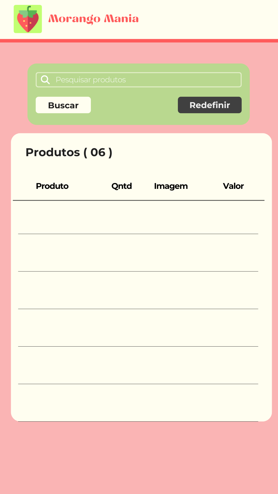
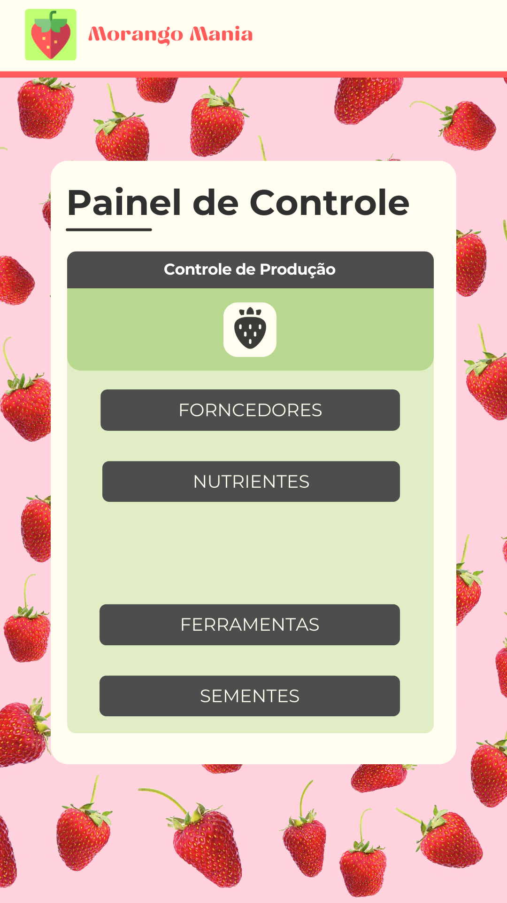
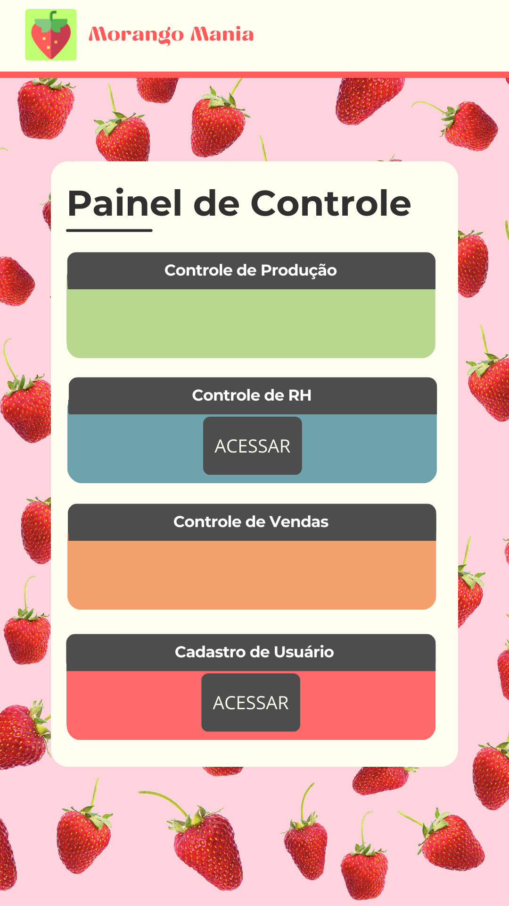

# 📱 Fazenda Morango Mania - Mobile App

## 📖 Sobre o Projeto

O aplicativo móvel do **Fazenda Morango Mania** é uma extensão do sistema de gestão da fazenda, levando a experiência de compra diretamente para a mão do cliente. Desenvolvido nativamente em **Java para Android**, o app permite que consumidores naveguem pelo catálogo de morangos, gerenciem seu carrinho de compras, cadastrem endereços de entrega e realizem pagamentos de forma ágil.

Além da interface do cliente, o aplicativo possui um fluxo dedicado para **colaboradores**, permitindo acesso a funcionalidades administrativas e operacionais em mobilidade.

---

## 🖼️ Telas do Aplicativo

| Lista de produtos | Controle de Produção | Painel de Controle |
| :---: | :---: | :---: |
|  |  |  |

---

## 🚀 Funcionalidades

### 👤 Módulo Cliente
- **Catálogo de Produtos:** Visualização de morangos (Albion, Camarosa, San Andreas, Sweet Charlie) com imagens e descrições.
- **Carrinho de Compras:** Adição e remoção de itens, cálculo de subtotal.
- **Gestão de Endereços:** Cadastro de múltiplos endereços de entrega com busca automática de CEP (Integração `CepService`).
- **Checkout e Pagamento:**
    - Pagamento via **Cartão de Crédito**.
    - Pagamento via **Pix** (Geração de QR Code).
- **Perfil do Usuário:** Edição de dados cadastrais.

### 👨‍🌾 Módulo Colaborador
- **Acesso Restrito:** Login diferenciado para funcionários.
- **Painel de Controle:** Acesso rápido a funções administrativas mobile.
- **Gestão de Cadastros:** Edição e visualização de informações.

---

## 🛠️ Tecnologias Utilizadas

* **Linguagem:** Java (Android SDK)
* **Interface (UI):** XML Layouts
* **Banco de Dados:** SQL Server (Conexão direta via JDBC com driver jTDS)
* **Conectividade:**
    * `jtds-1.3.1.jar`: Driver JDBC open source para conexão com SQL Server.
    * `CepService`: Serviço para consulta de endereços.
* **Bibliotecas:**
    * `ZXing` (provável uso para QR Codes
